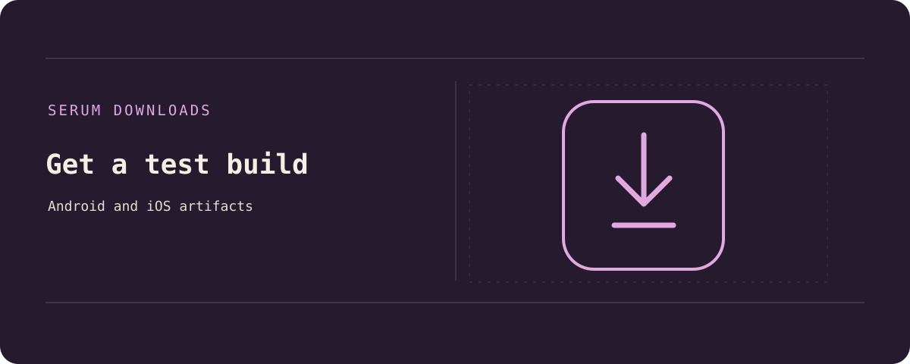

# Serum Downloads

Public builds of [Serum](https://serumlog.com): an Android APK and an unsigned iOS archive for developers. The app source lives in a private repository.

Android is published only by a manually dispatched, credentialed store build
after both the APK and AAB pass the Leyline Labs certificate-fingerprint gate.

## Table of Contents

- [Technologies](#technologies)
- [Android](#android)
- [iOS](#ios)
- [License](#license)

## Technologies

- [Android](https://developer.android.com/)
- [Apple Developer](https://developer.apple.com/)

## Android

Download [`serum.apk`](serum.apk) and open it. This file must originate from
the source repository's credentialed store workflow; debug-signed Android
artifacts are rejected before publication. You may need to enable "Install
unknown apps" for your browser in Android settings first.

Works on Android 8.0 and up.

## iOS

[`serum-ios-unsigned.zip`](serum-ios-unsigned.zip) is an unsigned build for developers, not a ready-to-install iPhone download. Don't open this ZIP directly in a sideloading tool.

[Sideloadly](https://sideloadly.io/) runs on macOS and Windows and takes an `.ipa`. [AltStore Classic](https://faq.altstore.io/altstore-classic/error-codes) also takes an `.ipa`.

The macOS helper [`sign_ios.sh`](sign_ios.sh) is designed to package the app as `Serum.ipa` using an Apple signing identity. Installation of the current build on an iPhone has not been verified.

## License

These builds are distributed under the same license as the upstream
Serum project.
